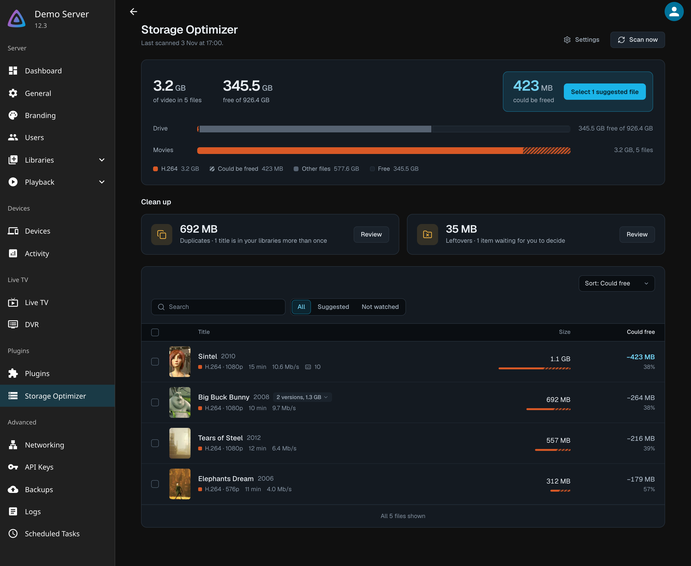
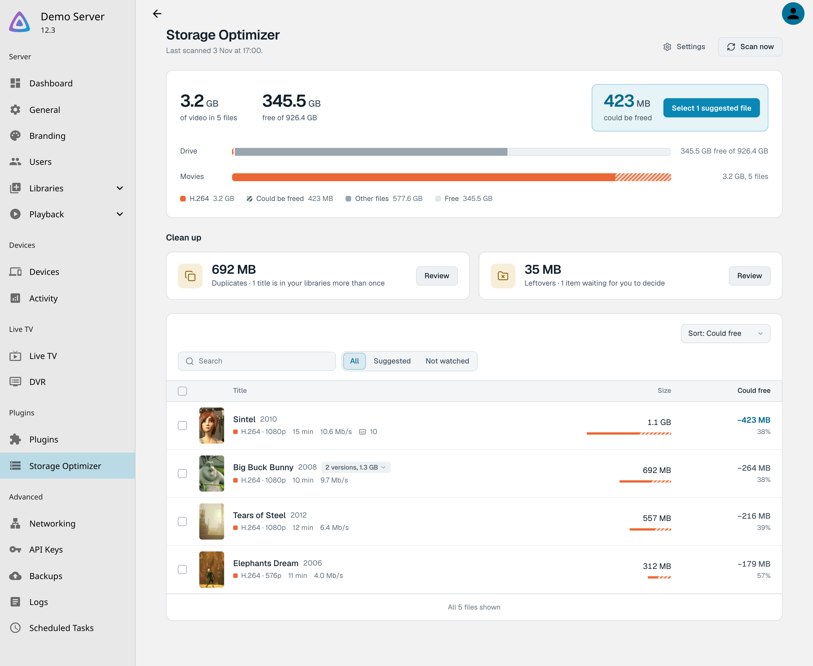
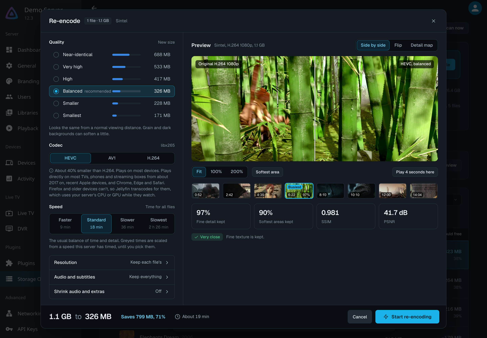
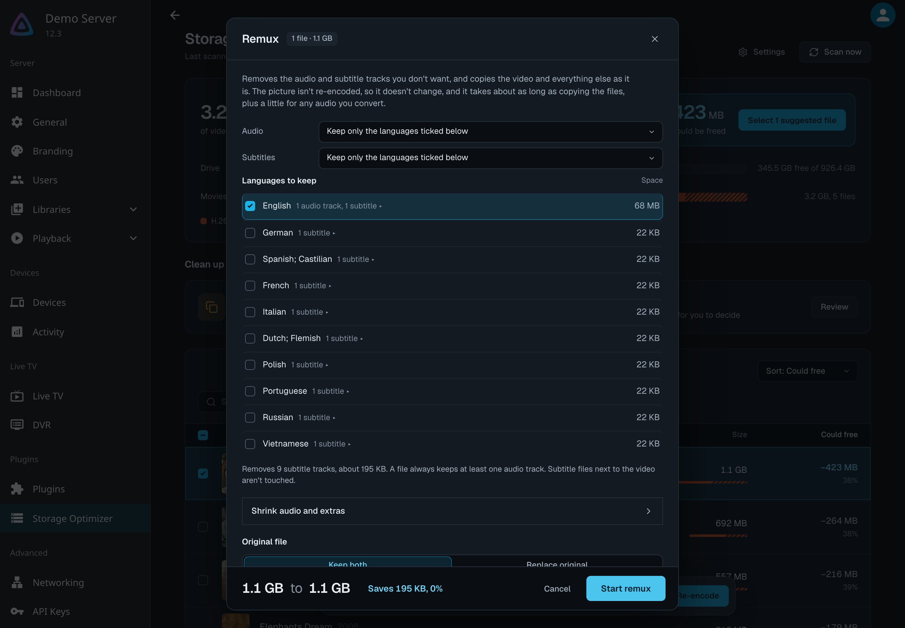
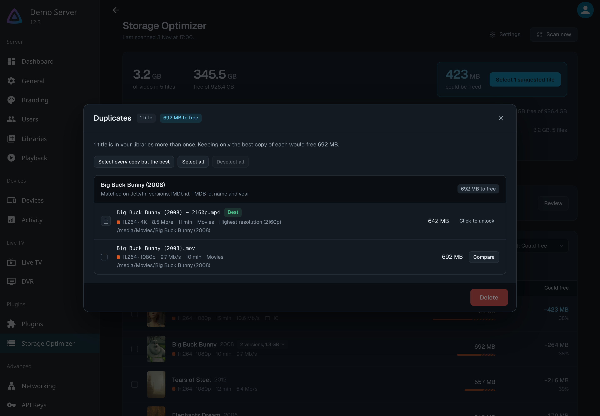
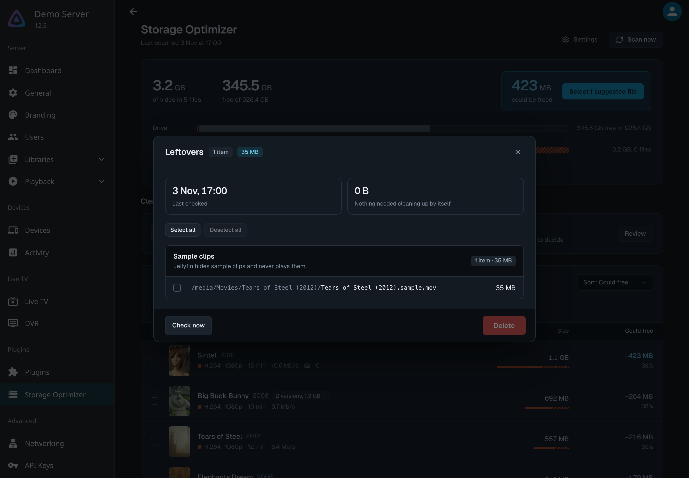
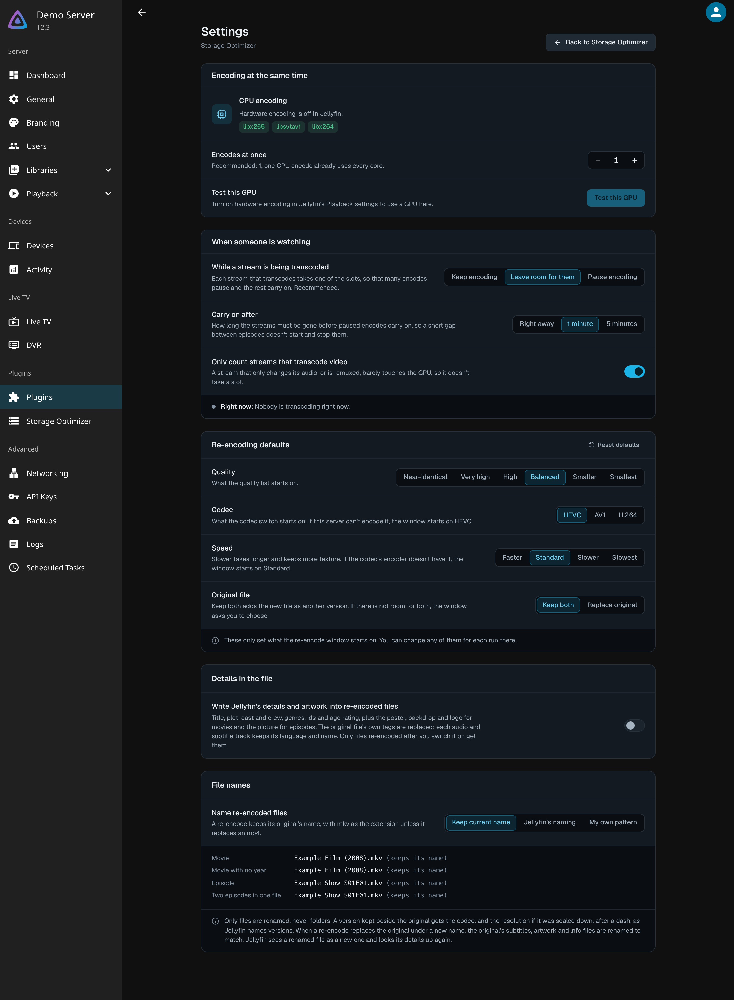
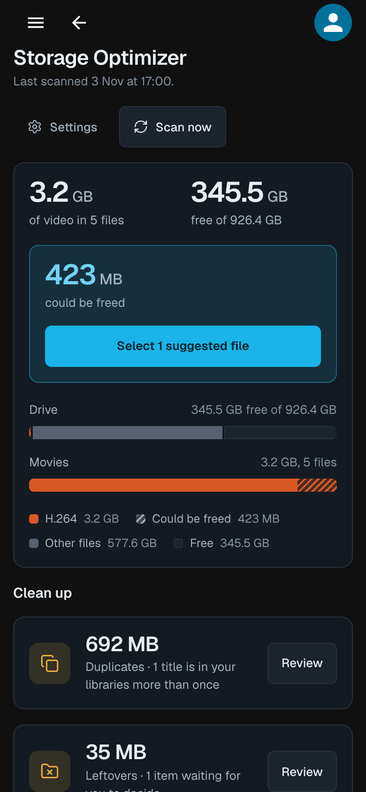

# Storage Optimizer for Jellyfin

An unofficial plugin for Jellyfin that shows where your library's storage is going and gives you tools to reduce it.

**Built with AI.** Almost all of the code in this plugin was written by [Claude](https://claude.ai), an AI assistant made by Anthropic. Anthropic hasn't reviewed, endorsed or supported this plugin. There are unit tests for the file naming, track selection, sidecar and leftover rules; the encoding and deleting itself has only been tried by hand. If something doesn't work, please [open an issue](https://github.com/CyanicTempest/jellyfin-plugin-storage-optimizer/issues) and say what you saw.



*Demo media: open movies by the Blender Foundation (CC BY). See [Credits](#credits).*

It can:

- **Show where your storage goes**, by library, folder and codec, and estimate how much you could free. These are estimates, and the real size of a re-encode can differ.
- **Re-encode videos** to HEVC or AV1 with a preview on real frames from your own files, so you can see what you'd give up before you start.
- **Remux** a file to drop audio and subtitle tracks you never use, without touching the picture.
- **Shrink audio and extras:** convert big lossless audio to something smaller, remove Dolby Vision (keeping HDR10), turn HDR into SDR, and skip embedded fonts and cover art.
- **Accept smaller files in bulk:** when re-encodes you kept beside their originals come out smaller, review them, compare them, and delete the originals in one go.
- **Find duplicates:** the same movie or episode in your library more than once, with the best copy marked.
- **Find media nobody watches**, so you can shrink it harder or let it go.
- **Clean up leftovers:** orphaned metadata and trickplay folders, and sample clips.
- **Use your GPU** when Jellyfin is set up for it (NVIDIA, Intel Quick Sync Video, and AMD on Windows or on Linux through VA-API, which is experimental; only NVIDIA has had much real-world use), run several encodes at once if your hardware can, and step aside while Jellyfin is transcoding a stream for someone.

<details>
<summary>More screenshots</summary>

| | |
|---|---|
|  |  |
|  |  |
|  |  |

It works on a phone too:



</details>

## Warning

This plugin re-encodes, remuxes, replaces and deletes media files. It is early software, written by an AI and not widely tested, and it may have bugs that damage or delete files. Don't rely on it for anything you can't replace.

- Back up your media before using it, and try each setting on a copy first.
- Deleting videos asks for confirmation, and re-encodes keep the original unless you choose to replace it. Those prompts don't make a bug impossible.
- Checking for leftovers lists orphaned Jellyfin metadata and trickplay folders, and sample clips, for you to review. It runs when you press **Check now** or add it as a schedule under **Dashboard > Scheduled Tasks**, and it deletes nothing by itself. Sample clips are only deleted after you confirm.
- NVIDIA hardware encoding has had the most use. Intel Quick Sync Video, AMD, AV1 and Dolby Vision removal have had much less.
- It comes with no warranty, as the licence below explains.

## Your media

Storage Optimizer only works on files already in your Jellyfin libraries. It doesn't download media, decrypt discs or streams, or bypass copy protection, and it ships no codecs: it runs the ffmpeg your Jellyfin server already uses. You are responsible for having the right to keep and convert the files you use it on.

## What it does on your server

- It makes no network requests of its own. There is no telemetry, update check or download in its code.
- It runs the ffmpeg and ffprobe that Jellyfin already uses. To find your GPU it can also run `nvidia-smi`, `lspci` or PowerShell.
- It writes new files next to the originals. An unfinished encode is a hidden partial file that is cleaned up if the encode fails or is cancelled. It also keeps a few small report files in its own plugin data folder.
- It deletes only what you confirm in the dashboard.
- Every route it adds to Jellyfin's API needs an administrator.

## Install

In Jellyfin, go to **Dashboard > Plugins > Repositories > Add** and enter:

```
https://raw.githubusercontent.com/CyanicTempest/jellyfin-plugin-storage-optimizer/dist/manifest.json
```

Then open **Catalog**, find **Storage Optimizer**, install it and restart Jellyfin. Updates arrive the same way.

Prefer to do it by hand? Put `Jellyfin.Plugin.DataManager.dll` in a folder such as `plugins/StorageOptimizer` inside Jellyfin's data directory and restart Jellyfin.

It needs Jellyfin 12.3. To build it yourself you need the .NET 10 SDK: `dotnet publish Jellyfin.Plugin.DataManager -c Release -o build-output`.

## Not affiliated

Storage Optimizer is an independent, community-made plugin. It isn't made, endorsed, sponsored or supported by the Jellyfin project, Anthropic, or any company named on this page. Anthropic is not responsible for this plugin.

"Jellyfin" and the Jellyfin logo belong to the Jellyfin project. They're used here only to say which server this works with, and the logo appears only because the screenshots show the Jellyfin interface. The plugin has its own name and uses no Jellyfin logo of its own.

Other names are the property of their owners and are used only to describe what the plugin works with. NVIDIA is a trademark of NVIDIA Corporation. Intel and Intel Quick Sync Video are trademarks of Intel Corporation or its subsidiaries. AMD and Radeon are trademarks of Advanced Micro Devices, Inc. Dolby, Dolby Vision, Dolby Atmos and Dolby Digital Plus are trademarks of Dolby Laboratories. AV1 is a trademark of the Alliance for Open Media. FFmpeg is a trademark of Fabrice Bellard. DTS and HDR10+ are trademarks of their respective owners. No affiliation with or endorsement by any of them is implied.

## Licence

This is free software, released under the [GNU General Public License v3.0](LICENSE) (GPL-3.0-only), the same licence as the Jellyfin packages it is built against. You may use, change and share it, as long as shared copies stay under the same licence. It comes with no warranty, as the licence explains.

The dashboard embeds the Geist font (SIL Open Font License 1.1) and Lucide icons (ISC and MIT). Their full licence texts are in [THIRD-PARTY-NOTICES.md](THIRD-PARTY-NOTICES.md), which also ships inside the plugin zip.

## Credits

The screenshots use a demo library of open movies made by the Blender Foundation, released under Creative Commons Attribution licences. Every picture of a film in them, including the poster images, is a frame from that film, cropped and scaled, and the re-encode preview shows a frame beside a version re-encoded by this plugin. The Blender Foundation has not endorsed this plugin.

- *Big Buck Bunny*, (c) copyright 2008, Blender Foundation / www.bigbuckbunny.org, [CC BY 3.0](https://creativecommons.org/licenses/by/3.0/)
- *Elephants Dream*, (c) copyright 2006, Blender Foundation / Netherlands Media Art Institute / www.elephantsdream.org, [CC BY 2.5](https://creativecommons.org/licenses/by/2.5/)
- *Sintel*, (c) copyright Blender Foundation | www.sintel.org, [CC BY 3.0](https://creativecommons.org/licenses/by/3.0/)
- *Tears of Steel*, (CC) Blender Foundation | mango.blender.org, [CC BY 3.0](https://creativecommons.org/licenses/by/3.0/)

The images in `docs/screenshots` show these third-party works and the Jellyfin web interface. They are not part of this plugin's GPL-licensed code and keep their own licences.
